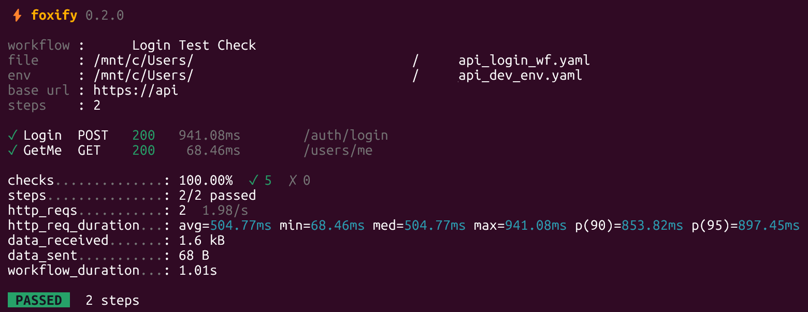

# ⚡ Foxify

[](https://github.com/kikutano/foxify/actions/workflows/ci.yml)
[](https://github.com/kikutano/foxify/releases)
[](License.md)

API testing from the command line. Describe HTTP calls, variable extraction and assertions in a YAML file, and run them with one command. Foxify is a single Native AOT binary: no runtime to install, and it starts instantly.

<p align="center">
  
</p>

## Install

**Linux / macOS**

```bash
curl -fsSL https://raw.githubusercontent.com/kikutano/foxify/main/install.sh | sh
```

**Windows (PowerShell)**

```powershell
irm https://raw.githubusercontent.com/kikutano/foxify/main/install.ps1 | iex
```

Or download the archive for your platform from [Releases](https://github.com/kikutano/foxify/releases) (`win-x64`, `linux-x64`, `linux-arm64`, `osx-arm64`) and put `foxify` on your `PATH`.

Check that it works:

```bash
foxify --version
```

### Update

```bash
foxify update
```

It downloads the latest release for your platform, verifies its SHA-256 checksum and replaces the binary in place. `foxify update --check` only tells you whether a newer version exists. Re-running the install script works too, and `FOXIFY_VERSION=0.1.0` pins a specific version.

## Quick start

`env.yaml`:

```yaml
baseUrl: "https://jsonplaceholder.typicode.com"
```

`hello.yaml`:

```yaml
metadata:
  name: "Hello Foxify"

functions:
  CreatePost:
    type: HTTP_REQUEST
    method: POST
    endpoint: "/posts"
    headers:
      Content-Type: application/json
    body: |
      { "title": "foxify", "body": "hello", "userId": 1 }
    expected:
      status_code: 201
    extract:
      postId: $.id            # save a value from the JSON response
    asserts:
      postId: "== 101"        # check an extracted value

  GetUser:
    type: HTTP_REQUEST
    method: GET
    endpoint: "/users/1"
    expected:
      status_code: 200
    extract:
      email: $.email
    asserts:
      email: "== 'Sincere@april.biz'"

workflow:
  - type: function
    function_name: CreatePost
  - type: function
    function_name: GetUser
    depends_on: [CreatePost]
```

Run it:

```bash
foxify run hello.yaml -e env.yaml
```

```text
  ⚡ foxify 0.1.0

  workflow : Hello Foxify
  file     : hello.yaml
  env      : env.yaml
  base url : https://jsonplaceholder.typicode.com
  steps    : 2

  ✓ CreatePost  POST   201   658.74ms  /posts
  ✓ GetUser     GET    200    41.52ms  /users/1

  checks..............: 100.00%  ✓ 4  ✗ 0
  steps...............: 2/2 passed
  http_reqs...........: 2  2.61/s
  http_req_duration...: avg=350.13ms min=41.52ms med=350.13ms max=658.74ms p(90)=597.02ms p(95)=627.88ms
  data_received.......: 579 B
  data_sent...........: 52 B
  workflow_duration...: 767.26ms

   PASSED   2 steps
```

When a step fails, every assert of that step is listed with the actual value, and the steps after it are not run:

```text
  ✗ GetUser     GET    200   227.05ms  /users/1
      ✗ email == 'nobody@example.com'  actual 'Sincere@april.biz'
      ✓ city == 'Gwenborough'
```

## Usage

```text
foxify run <workflow.yaml> [options]
foxify update [--check] [--force]
foxify --help
foxify --version

Options for 'run':
  -e, --env <file>   Environment file (YAML) with initial variables, e.g. baseUrl, apiKey.
  -v, --verbose      Print variables, requests and responses while running.
  --no-color         Disable colors (also honored: the NO_COLOR environment variable).

Options for 'update':
  --check            Only tell whether a newer version is available.
  --force            Reinstall the latest version, also over a development build.

  -h, --help         Show this help.
  --version          Show the version.

Exit codes ('run'):
  0  all steps passed
  1  at least one step failed
  2  invalid arguments or file not found
```

Execution stops at the first failing step. The exit code makes Foxify easy to use in CI. When the output is not a terminal (CI logs, pipes) the spinner is turned off and each step is printed on its own line.

## Workflow file

| Key | Description |
|---|---|
| `metadata.name` | Name shown in the report. |
| `functions.<Name>` | A reusable HTTP request: `method`, `baseurl` (optional, defaults to `baseUrl` from the env file), `endpoint`, `headers`, `body`. |
| `expected.status_code` | Expected HTTP status code. |
| `extract` | `variable: <JSONPath>` pairs, e.g. `$.token`, `$.data[0].id`, `$.user.address.city`. |
| `asserts` | Checks on extracted variables: `==`, `!=`, `>`, `>=`, `<`, `<=`, combinable with `&&` and `\|\|`. |
| `workflow` | Steps run in order: `type: function` with `function_name` (and optional `depends_on`), or `type: DELAY` with `duration_seconds`. |
| `variables`, `metadata.variables` | Default variables. Values in the env file override them. |
| `settings.timeout` | Timeout of each HTTP request, in seconds (default 30). |
| `settings.max_retries` | Retries on network errors and timeouts (default 3). HTTP error status codes are never retried. |

Use `${name}` anywhere in `baseurl`, `endpoint`, `headers` or `body` to reference variables from the env file, the workflow defaults or values extracted by earlier steps, e.g. `Authorization: "Bearer ${token}"`. Referencing a variable that is not defined fails the step.

More details: [docs/variable_extraction_guide.md](docs/variable_extraction_guide.md).

## Full example

[docs/full_example.yaml](docs/full_example.yaml) covers authentication, CRUD, nested JSON, headers, query strings, status codes and delays against the bundled test server:

```bash
# terminal 1: start the test server on http://localhost:5122
dotnet run --project tests/Foxify.RealServer.Tests
```

```bash
# terminal 2: run the workflow
foxify run docs/full_example.yaml -e docs/environment.yaml
```

The workflow changes the server's in-memory data (it deletes a user), so restart the server before running it again.

## Build from source

Requires the [.NET 10 SDK](https://dotnet.microsoft.com/download). Native AOT also needs the platform toolchain: the "Desktop development with C++" workload on Windows, `clang` and `zlib1g-dev` on Linux, Xcode command line tools on macOS.

```bash
git clone https://github.com/kikutano/foxify.git
cd foxify
dotnet test Foxify.slnx

# run without installing
dotnet run --project src/Foxify.Cli -- run docs/full_example.yaml -e docs/environment.yaml

# build the native binary (use your RID: win-x64, linux-x64, linux-arm64, osx-arm64)
dotnet publish src/Foxify.Cli/Foxify.Cli.csproj -c Release -r linux-x64 -o publish
```

## Releasing

Push a SemVer tag. The [Release workflow](.github/workflows/release.yml) runs the tests, builds the native binaries for every platform and publishes a GitHub Release with checksums and generated notes:

```bash
git tag v0.1.0
git push origin v0.1.0
```

Tags with a suffix, like `v0.2.0-beta.1`, are published as pre-releases.

## Roadmap

See [ROADMAP.md](ROADMAP.md).

## License

MIT. See [License.md](License.md).
